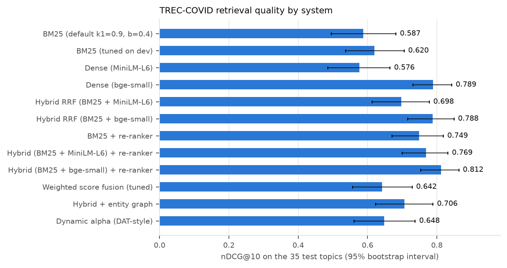
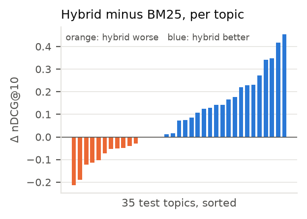
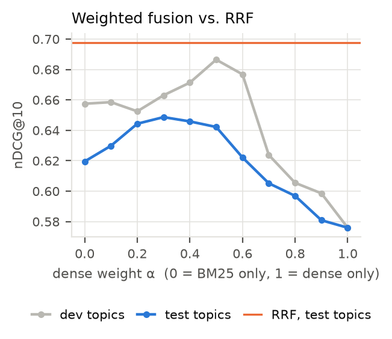
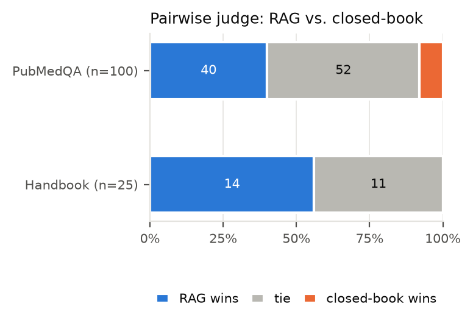
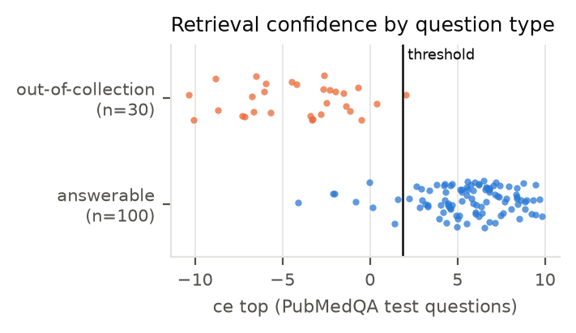
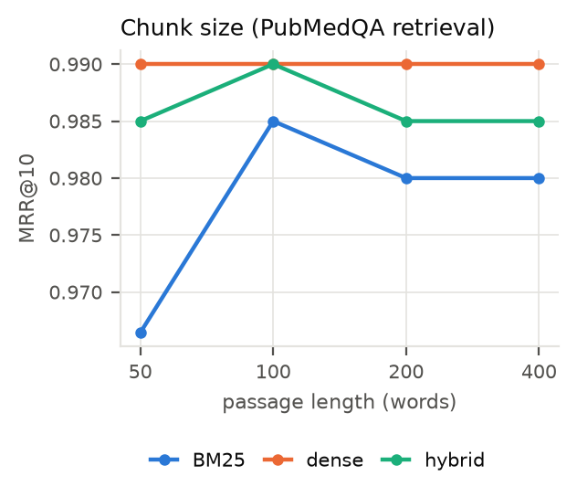

# Results

Generated by `scripts/06_make_report.py` from the files in `results/`. Every number below was produced by the pipeline on this machine.

- Machine: Linux-6.8.0-138-generic-x86_64-with-glibc2.35, 32 cores, 124.9 GB RAM, PyTorch device `cuda`
- Generator LLM: `llama3.1:8b` · judge / verifier LLM: `qwen2.5:7b` (both local, temperature 0)
- TREC-COVID: 171,332 documents, 238,432 passages of ~200 words; 15 dev / 35 test topics; dense models: MiniLM-L6, bge-small
- PubMedQA: 950 abstracts indexed; 100 answerable + 30 out-of-collection test questions; top-k = 3

## Success criteria from the proposal

| Criterion | Outcome | Evidence |
|---|---|---|
| Hybrid matches or beats the better single retriever on nDCG@10 (TREC-COVID test topics) | **met** | hybrid 0.698 vs. BM25 0.620 (BM25 0.620, dense 0.576) |
| RAG wins most pairwise comparisons against the closed-book LLM (PubMedQA) | **partly met** | RAG wins 40, ties 52, closed-book wins 8 of 100 (sign test, p < 0.001) |
| Abstention catches most out-of-collection questions without over-refusing (PubMedQA; operationalised as more than half caught and at most 10% of answerable questions refused) | **met** | 30 of 30 out-of-collection questions declined (100.0%); 9 of 100 answerable questions declined (9.0%) |

## What the numbers show

- Retrieval. On the 35 TREC-COVID test topics, tuned BM25 reaches nDCG@10 = 0.620, the dense bi-encoder (MiniLM-L6) 0.576, and their reciprocal rank fusion 0.698. Hybrid is above BM25, the better single retriever, by 0.078 (paired randomisation test, p = 0.009; hybrid better on 20 topics, worse on 11). An oracle that picks the better of the two retrievers per topic would reach 0.678, and the two top-10 lists share 7% of their documents on average.
- With the bge-small encoder, dense retrieval reaches nDCG@10 = 0.789 and the hybrid 0.788 (BM25: 0.620).
- Re-ranking the top 50 fused documents with the cross-encoder changes hybrid nDCG@10 from 0.698 to 0.769 (+0.071, p = 0.027).
- Adding the entity-graph ranker changes hybrid nDCG@10 from 0.698 to 0.706 (+0.009, p = 0.280).
- The DAT-style per-query weighting reaches 0.648 against 0.698 for fixed RRF (-0.050, p = 0.070).
- Answers. On the 100 answerable PubMedQA test questions the judge (qwen2.5:7b) preferred the RAG answer 40 times, the closed-book answer 8 times, and found no consistent winner 52 times (two-sided sign test, p < 0.001). When RAG did answer (91 questions) it won 39 and lost 3.
- On the yes / no / maybe label, the closed-book llama3.1:8b scores 60.0% and RAG 76.0% (majority-class baseline 61.0%); RAG answered 91.0% of the questions and was right on 83.5% of those it answered.
- Grounding. ALCE-style citation precision is 51.2% and citation recall 36.3% over 168 statements and 129 citations. RAGAs-style faithfulness averages 90.9% over 306 claims, and 73.6% of answers have every claim supported. The post-check found an out-of-range citation number in 0.0% of answers and no citation on 25.5% of sentences.
- Abstention. The system declined 30 of 30 out-of-collection questions (100.0%) and wrongly declined 9 of 100 answerable ones (9.0%). The LLM's own refusals account for 26 and 2 of these; the rest come from the ce top threshold. The closed-book model said it did not know on 3.3% of the out-of-collection questions.
- Handbook demo set. Of 25 answerable hand-written questions the system answered 19 (judge: RAG wins 14, ties 11, closed-book wins 0), and it declined 10 of 10 out-of-collection questions. The LLM's own refusals account for 9 and 0 of these; the rest come from the ce top threshold tuned on PubMedQA (with the LLM's refusals alone the system would answer 25 of the 25 answerable questions).

## Retrieval: TREC-COVID

TREC-COVID retrieval. nDCG@10 (± half-width of the 95% bootstrap interval), Recall@100 and capped Recall@100 on the 35 test topics; the last column is nDCG@10 on all 50 topics for comparison with published BEIR numbers (the 15 dev topics were used for tuning).

| System | nDCG@10 | R@100 | R_cap@100 | nDCG@10 (all) |
|---|---:|---:|---:|---:|
| BM25 (default k1=0.9, b=0.4) | 0.587 ± 0.093 | 0.095 | 0.482 | 0.584 |
| BM25 (tuned on dev) | 0.620 ± 0.084 | 0.100 | 0.502 | 0.631 |
| Dense (MiniLM-L6) | 0.576 ± 0.090 | 0.093 | 0.451 | 0.576 |
| Dense (bge-small) | 0.789 ± 0.056 | **0.122** | **0.585** | 0.783 |
| Hybrid RRF (BM25 + MiniLM-L6) | 0.698 ± 0.082 | 0.103 | 0.505 | 0.713 |
| Hybrid RRF (BM25 + bge-small) | 0.788 ± 0.067 | 0.120 | 0.581 | **0.785** |
| BM25 + re-ranker | 0.749 ± 0.074 | 0.100 | 0.502 | 0.723 |
| Hybrid (BM25 + MiniLM-L6) + re-ranker | 0.769 ± 0.066 | 0.103 | 0.505 | 0.747 |
| Hybrid (BM25 + bge-small) + re-ranker | **0.812 ± 0.055** | 0.120 | 0.581 | 0.768 |
| Weighted score fusion (tuned) | 0.642 ± 0.086 | 0.103 | 0.505 | 0.655 |
| Hybrid + entity graph | 0.706 ± 0.083 | 0.103 | 0.505 | 0.718 |
| Dynamic alpha (DAT-style) | 0.648 ± 0.088 | 0.104 | 0.516 | 0.641 |

## Retrieval: paired significance tests

Paired comparisons on the TREC-COVID test topics (nDCG@10): mean difference A − B, topics won / lost by A, and the two-sided paired randomisation test.

| A | B | Δ nDCG@10 | wins / losses | p |
|---|---:|---:|---:|---:|
| Hybrid RRF (BM25 + MiniLM-L6) | BM25 (tuned on dev) | +0.078 | 20 / 11 | 0.009 |
| Hybrid RRF (BM25 + MiniLM-L6) | Dense (MiniLM-L6) | +0.122 | 22 / 12 | <0.001 |
| Hybrid (BM25 + MiniLM-L6) + re-ranker | Hybrid RRF (BM25 + MiniLM-L6) | +0.071 | 25 / 6 | 0.027 |
| BM25 + re-ranker | BM25 (tuned on dev) | +0.129 | 22 / 10 | 0.002 |
| Hybrid + entity graph | Hybrid RRF (BM25 + MiniLM-L6) | +0.009 | 13 / 11 | 0.280 |
| Weighted score fusion (tuned) | Hybrid RRF (BM25 + MiniLM-L6) | -0.055 | 12 / 19 | 0.014 |
| Dynamic alpha (DAT-style) | Hybrid RRF (BM25 + MiniLM-L6) | -0.050 | 13 / 18 | 0.070 |
| BM25 (tuned on dev) | BM25 (default k1=0.9, b=0.4) | +0.032 | 18 / 14 | 0.064 |
| Hybrid RRF (BM25 + bge-small) | BM25 (tuned on dev) | +0.168 | 29 / 3 | <0.001 |
| Hybrid RRF (BM25 + bge-small) | Dense (bge-small) | -0.001 | 16 / 17 | 0.957 |
| Hybrid (BM25 + bge-small) + re-ranker | Hybrid RRF (BM25 + bge-small) | +0.025 | 16 / 16 | 0.308 |

## Ablation: fusion method

Fusion ablation on TREC-COVID (nDCG@10, BM25 + MiniLM-L6). α is the dense weight.

| Fusion method | dev | test |
|---|---:|---:|
| RRF, k=10 | 0.683 | 0.658 |
| RRF, k=30 | 0.718 | 0.669 |
| RRF, k=60 | 0.749 | 0.698 |
| RRF, k=100 | 0.748 | 0.690 |
| Weighted, α=0.5 (tuned on dev) | 0.686 | 0.642 |
| Weighted, α=0 (BM25 only) | 0.658 | 0.620 |
| Weighted, α=1 (dense only) | 0.576 | 0.576 |
| Dynamic α (DAT-style), mean α=0.34 | 0.624 | 0.648 |
| Hybrid + entity graph, w=0.25 | 0.745 | 0.706 |
| Hybrid + entity graph, w=0.50 | 0.744 | **0.710** |
| Hybrid + entity graph, w=1.00 | 0.723 | 0.699 |

## Retrieval latency

Retrieval latency on the TREC-COVID index (238,432 passages), mean over 20 queries.

| Mode | ms / query |
|---|---:|
| bm25 | 16 |
| dense | 16 |
| hybrid | 17 |
| hybrid + KG | 21 |
| hybrid + re-ranker | 52 |

## Retrieval: PubMedQA (known item)

PubMedQA known-item retrieval: finding the abstract a question was written about, among 950 abstracts (100 test questions).

| System | R@1 | R@5 | R@10 | MRR@10 |
|---|---:|---:|---:|---:|
| BM25 (default k1=0.9, b=0.4) | 0.970 | 0.990 | 0.990 | 0.980 |
| BM25 (tuned on dev) | 0.970 | 0.990 | 0.990 | 0.980 |
| Dense (MiniLM-L6) | 0.980 | **1.000** | **1.000** | 0.990 |
| Dense (bge-small) | **1.000** | **1.000** | **1.000** | **1.000** |
| Hybrid RRF (BM25 + MiniLM-L6) | 0.980 | 0.990 | 0.990 | 0.985 |
| Hybrid RRF (BM25 + bge-small) | 0.980 | 0.990 | 0.990 | 0.985 |
| BM25 + re-ranker | 0.990 | 0.990 | 0.990 | 0.990 |
| Hybrid (BM25 + MiniLM-L6) + re-ranker | 0.990 | 0.990 | **1.000** | 0.991 |
| Hybrid (BM25 + bge-small) + re-ranker | 0.990 | 0.990 | **1.000** | 0.991 |
| Weighted score fusion (tuned) | 0.990 | 0.990 | **1.000** | 0.991 |
| Hybrid + entity graph | 0.980 | 0.990 | 0.990 | 0.985 |

## Answers: pairwise judge

Pairwise LLM-as-a-judge against the reference answer: RAG vs. the closed-book LLM on answerable test questions. A system wins only if the judge prefers it in both presentation orders; p is a two-sided sign test on wins vs. losses; the last column is the share of comparisons where both orders agreed.

| Benchmark | n | RAG wins | ties | closed-book wins | p | order-consistent % |
|---|---:|---:|---:|---:|---:|---:|
| PubMedQA | 100 | 40 (40.0%) | 52 (52.0%) | 8 (8.0%) | <0.001 | 67.0 |
| Handbook | 25 | 14 (56.0%) | 11 (44.0%) | 0 (0.0%) | <0.001 | 68.0 |

## Answers: yes / no / maybe accuracy

PubMedQA yes / no / maybe accuracy on the 100 answerable test questions (95% Wilson intervals). A declined question counts as wrong; coverage is the share answered. McNemar exact test on discordant pairs: p = 0.005 (RAG only correct on 23, closed-book only on 7).

| System | Accuracy % | Coverage % | Acc. when answered % |
|---|---:|---:|---:|
| Majority class | 61.0 | 100.0 | -- |
| Closed-book LLM | 60.0 [50.2, 69.1] | 100.0 | -- |
| RAG (ours) | 76.0 [66.8, 83.3] | 91.0 | 83.5 |

## Groundedness: citations and faithfulness

Groundedness of the RAG answers that were not declined. Citation precision / recall use entailment by DeBERTa-v3 NLI on windows of 2 consecutive passage sentences (maximum over windows); a bare Yes / No / Maybe sentence is not scored. Faithfulness is the share of atomic claims the judge model finds supported by the retrieved passages.

| Metric | PubMedQA | Handbook |
|---|---:|---:|
| Answers evaluated | 91 | 19 |
| Citation precision (ALCE-style) % | 51.2 | 83.3 |
| Citation recall (ALCE-style) % | 36.3 | 71.4 |
| Faithfulness (RAGAs-style) % | 90.9 | 90.8 |
| Fully faithful answers % | 73.6 | 78.9 |
| Answers citing the gold document % | 100.0 | 100.0 |
| Answers with an invalid citation number % | 0.0 | 5.3 |
| Sentences without a citation % | 25.5 | 16.7 |
| Answers with a number absent from cited passages % | 3.3 | 21.1 |
| Citations per answer | 1.23 | 1.11 |

## Abstention and over-refusal

Abstention. Left: out-of-collection questions correctly declined (abstention accuracy). Right: answerable questions wrongly declined (over-refusal). The score threshold uses the signal ce_top with threshold 1.8739, both chosen on the PubMedQA dev questions and transferred unchanged to the handbook.

| Policy | Declined out-of-collection | Declined answerable | F1 |
|---|---:|---:|---:|
| PubMedQA: LLM declines | 26 / 30 (86.7%) | 2 / 100 (2.0%) | 0.90 |
| PubMedQA: Score threshold | 29 / 30 (96.7%) | 8 / 100 (8.0%) | 0.87 |
| PubMedQA: Both (system) | 30 / 30 (100.0%) | 9 / 100 (9.0%) | 0.87 |
| PubMedQA: closed-book says it does not know | 3.3% | 3.0% | -- |
| Handbook: LLM declines | 9 / 10 (90.0%) | 0 / 25 (0.0%) | 0.95 |
| Handbook: Score threshold | 10 / 10 (100.0%) | 6 / 25 (24.0%) | 0.77 |
| Handbook: Both (system) | 10 / 10 (100.0%) | 6 / 25 (24.0%) | 0.77 |
| Handbook: closed-book says it does not know | 80.0% | 36.0% | -- |

## Abstention signals

Retrieval-confidence signals for abstention on PubMedQA. AUROC measures how well each signal separates answerable from out-of-collection questions. Each signal gets its own threshold, tuned on the dev questions (20 out-of-collection and 40 answerable); the last four columns give the percentage of out-of-collection questions that threshold catches and of answerable questions it wrongly refuses, on dev and when applied unchanged to the held-out test questions (30 out-of-collection and 100 answerable). * marks the signal used by the system.

| Signal | AUROC dev | AUROC test | caught dev | refused dev | caught test | refused test |
|---|---:|---:|---:|---:|---:|---:|
| Top dense cosine similarity | 0.976 | 0.960 | 100.0 | 5.0 | 93.3 | 15.0 |
| Top RRF score (as proposed) | 0.786 | 0.776 | 60.0 | 5.0 | 63.3 | 13.0 |
| Top BM25 score | 0.941 | 0.919 | 85.0 | 2.5 | 63.3 | 8.0 |
| Top cross-encoder score * | **0.984** | **0.986** | 95.0 | 5.0 | 96.7 | 8.0 |
| BM25 / dense top-10 overlap | 0.566 | 0.633 | 10.0 | 0.0 | 10.0 | 0.0 |

## Ablation: top-k

Number of passages given to the LLM (PubMedQA dev, 60 questions). 'Answerable correct' requires an answer with the right yes / no / maybe label; 'declined' is the share of out-of-collection questions the LLM refused; utility is the share of all dev questions handled correctly. * marks the value used on test.

| top-k | gold in top-k % | answerable correct % | declined % | utility % | prompt tokens | s / answer |
|---|---:|---:|---:|---:|---:|---:|
| k = 3 * | 100.0 | 75.0 | 80.0 | 76.7 | 938 | 0.6 |
| k = 5 | 100.0 | 75.0 | 80.0 | 76.7 | 1412 | 0.7 |
| k = 8 | 100.0 | 72.5 | 80.0 | 75.0 | 2125 | 0.8 |

## Failure categories

Outcome of every test question, by category (each question gets exactly one category; see failures.csv for the examples).

| Outcome | PubMedQA | Handbook |
|---|---:|---:|
| Answerable: correct, cited and supported | 14 | 9 |
| Answerable: correct, but citation problem | 60 | 10 |
| Answerable: correct, but unsupported claim | 2 | 0 |
| Answerable: wrong conclusion (gold passage retrieved) | 15 | 0 |
| Answerable: declined (gold passage retrieved) | 8 | 6 |
| Answerable: gold passage not retrieved | 1 | 0 |
| Out-of-collection: declined | 30 | 10 |

## Ablation: chunk size (PubMedQA)

Chunk size ablation on PubMedQA known-item retrieval (100 test questions, dense model MiniLM-L6).

| Passage words | passages | BM25 MRR@10 | Dense MRR@10 | Hybrid MRR@10 | Hybrid R@1 | Hybrid R@5 |
|---|---:|---:|---:|---:|---:|---:|
| 50 (overlap 10) | 5,250 | 0.966 | **0.990** | 0.985 | 0.980 | **0.990** |
| 100 (overlap 20) | 2,636 | **0.985** | **0.990** | **0.990** | **0.990** | **0.990** |
| 200 (overlap 40) | 1,429 | 0.980 | **0.990** | 0.985 | 0.980 | **0.990** |
| 400 (overlap 80) | 950 | 0.980 | **0.990** | 0.985 | 0.980 | **0.990** |

## Ablation: chunk size (TREC-COVID)

Chunk size ablation on TREC-COVID (35 test topics, dense model MiniLM-L6).

| Passage words | passages | BM25 nDCG@10 | Dense nDCG@10 | Hybrid nDCG@10 | Hybrid R@100 |
|---|---:|---:|---:|---:|---:|
| 100 (overlap 20) | 395,348 | 0.590 | **0.637** | **0.727** | **0.110** |
| 200 (overlap 40) | 238,432 | 0.620 | 0.576 | 0.698 | 0.103 |
| 400 (overlap 80) | 174,085 | **0.641** | 0.520 | 0.685 | 0.105 |

## Ablation: retrieval mode, end to end

End-to-end effect of the retrieval mode on PubMedQA test answers (generator llama3.1:8b, top-k = 3, LLM abstention only).

| Retrieval mode | gold in top-k % | accuracy % | coverage % | declined out-of-coll. % | utility % |
|---|---:|---:|---:|---:|---:|
| BM25 | 99.0 | **81.0** | 98.0 | 83.3 | 81.5 |
| Dense | **100.0** | 80.0 | 97.0 | 80.0 | 80.0 |
| Hybrid (RRF) | 99.0 | **81.0** | 98.0 | 86.7 | **82.3** |
| Hybrid + re-ranker | 99.0 | 78.0 | 98.0 | 80.0 | 78.5 |
| Hybrid + entity graph | 99.0 | **81.0** | 98.0 | 80.0 | 80.8 |

## Human validation of the judge

Not done yet. Fill in the `human_verdict` column of `answers/pubmedqa/judge_handcheck.csv` (1, 2 or tie) and run `python scripts/score_handcheck.py`.

## Validation of the citation NLI model

165 cited (statement, passage) pairs, NLI (`cross-encoder/nli-deberta-v3-base`) against the judge LLM (`qwen2.5:7b`, which finds 84.2% entailed). The configured setting is `eval.citation_nli_window: 2` (0 = whole passage).

| NLI premise | entailed | agreement with judge | Cohen's kappa |
|---|---:|---:|---:|
| whole passage | 21.2% | 37.0% | 0.10 |
| 1-sentence windows | 52.7% | 61.2% | 0.19 |
| 2-sentence windows | 56.4% | 67.3% | 0.28 |
| 3-sentence windows | 50.3% | 62.4% | 0.25 |
| 4-sentence windows | 46.7% | 57.6% | 0.19 |

## Cost

LLM calls in the last answer-evaluation run: generator 0 new + 510 cached (0 s), judge 0 new + 474 cached (0 s).

Mean time per question on PubMedQA: retrieval 0.00 s, RAG generation 0.6 s (939 prompt tokens), closed-book generation 0.5 s. Cached calls report the time of the original call.

## Caveats

- TREC-COVID has 50 topics; with a 35-topic test split the confidence intervals are wide. Treat differences without a small p-value as inconclusive.
- The LLM judge and the faithfulness check are themselves models of about the same size as the generator; the hand-check above is the guard against judge error.
- ALCE-style citation precision says a cited passage supports the sentence, not that the model actually used it (Wallat et al., 2024).
- The out-of-collection questions are PubMedQA questions whose source abstract was withheld; a related abstract can occasionally still contain an answer.
- The handbook is a small fictional collection written for the demo, with hand-written questions.
